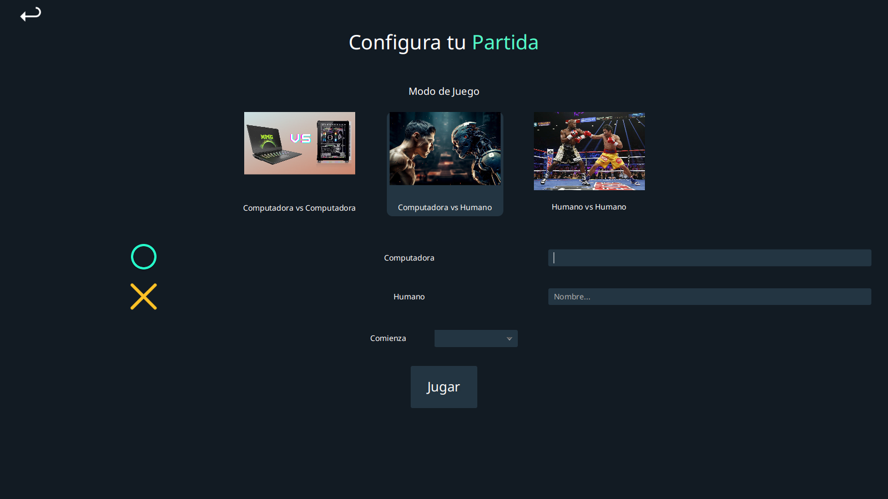
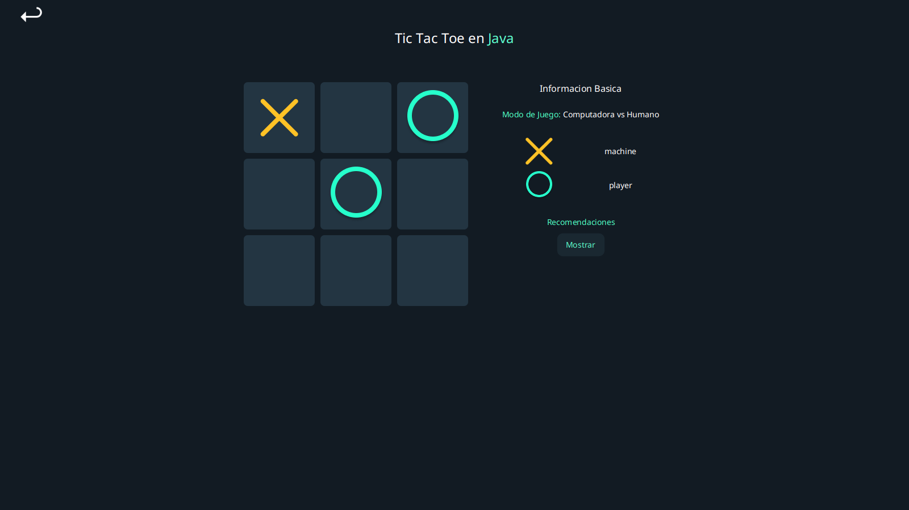

# Smart Tic-Tac-Toe

A JavaFX desktop game with human versus human, computer versus human, and computer versus computer modes.



## Run locally

Use a JDK, Maven, and a graphical desktop session. The project targets Java 11, and the commands below were verified on Linux with JDK 21. Maven downloads JavaFX on the first run.

From the repository root, run:

```sh
cd proyecto
mvn clean javafx:run
```

The Maven project lives in `proyecto/`. If Maven is installed with SDKMAN but the shell cannot find it, run `~/.sdkman/candidates/maven/current/bin/mvn clean javafx:run` from that directory.

## Play against the computer

1. Click **Jugar!** (Play) and select **Computadora vs Humano** (Computer vs Human).
2. Enter the player names, choose who starts in **Comienza** (Starts), and click **Jugar**.
3. Click an empty square on your turn. The computer replies automatically. Click **Mostrar** (Show) under **Recomendaciones** to see a suggested move.



## How the computer uses a game tree

[`Bot.makeDecition()`](proyecto/src/main/java/com/espol/tictactoe/model/Bot.java) builds a tree for the current turn. Each node in [`Tree<Matrix>`](proyecto/src/main/java/com/espol/tictactoe/ds/Tree.java) holds a complete board state.

1. **Root.** The current board becomes the root.
2. **Computer moves.** `thinkNextPlays()` copies the root board once for each empty square and places the computer's symbol there. Each resulting board becomes a child.
3. **Opponent replies.** For each candidate move, the same method adds a child board for each possible reply by the opponent.
4. **Score and choose.** [`Matrix.calculateUtility()`](proyecto/src/main/java/com/espol/tictactoe/model/Matrix.java) scores each reply board by subtracting the opponent's open winning lines from the computer's open winning lines. A line is open if none of its three squares contains the other side's mark. The bot takes the minimum reply score for each candidate and plays the candidate with the highest minimum. Ties go to the first candidate in row-by-row order.

For example, if one move's possible replies score **−2** and **3**, that move is assigned **−2**. A move whose replies score **0** and **1** gets **0**, so the bot prefers it. This is a two-move minimax-style search with a heuristic score. It looks ahead through one computer move and one opponent reply. When only one square remains, the bot fills it directly.

## How it’s built

JavaFX loads the FXML screens and displays the board. The game mode selects human or bot players, the `Matrix` model stores the nine squares, and the game controller updates the board and checks for wins or draws as players take turns.

## License

[MIT](LICENSE)
